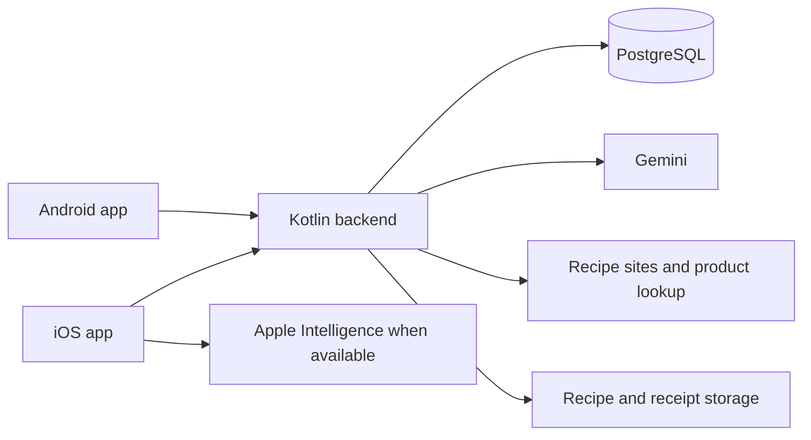

# Basil app plan

Draft, 1 October 2026.

Basil helps a busy household get fed with little effort. Start with food: keep
recipes you like, choose what to cook and for how many people, and get a list
of what is missing. Pantry tracking, shopping, AI, and budgets support this
flow. A detailed pantry setup or weekly meal plan must not be required before
the app is useful.

The requirements are a Kotlin backend, separate Android and iOS apps, preserved
and normalized recipes from recipe sites, scalable servings, missing lists,
barcode Add and Use actions, recipe and receipt scanning for costs, household
sharing, Gemini, and Apple Intelligence on supported iPhones with Gemini also
available. Frameworks and interaction defaults below remain proposals. This
document describes the planned product rather than an implemented application.

## The everyday flow

1. **Keep a recipe.** Share a recipe-site link into Basil, paste a link or text,
   or scan a recipe. Save a readable, normalized copy with its source.
2. **Choose food.** Select a favourite or ask for ideas using household stock.
   See what is ready and what needs only a few things, with the gaps explained.
3. **Choose servings.** Scale ingredients to the number of people and get a
   missing list immediately. Combine several recipes when useful.
4. **Shop.** Use the list, scan products to add stock, and scan the receipt to
   record spending. Remember products so repeat scans are quick.
5. **Eat.** Scan in Use mode to remove stock, or log a cooked recipe and apply
   its ingredients together. Keep these as convenient alternatives.
6. **Share the work.** Members use the same recipes, pantry, list, and budget,
   so each person's updates help the household.

The proposed home screen answers "What can we eat?" Recipes lead the app.
Offer favourites, quick meals, ready-to-cook and almost-ready suggestions, and
selected recipes with their missing list. Dated meal planning is optional.

## Core scope

| Part | What it does |
| --- | --- |
| Recipes | Preserve favourites from sites, text, and scans; normalize ingredients; support editing, servings, and scaling. |
| Pantry | Keep useful stock knowledge with quick Add and Use scans, manual shortcuts, optional amounts, and corrections. |
| Suggestions | Use Gemini or supported Apple Intelligence to suggest meals that use available stock or have a small shopping gap. |
| Shopping | Combine selected recipes into a missing list, preserve manual items, and support shopping without connectivity. |
| Costs | Estimate recipe and serving costs; scan receipts to record actual spending and improve price knowledge. |
| Household | Share recipes, stock, lists, and budgets through invitations and synchronized updates. |

Recipe-site imports, barcode actions, household sharing, and both kinds of cost
scanning are core requirements. Delivery can be staged. Retailer ordering, bank
feeds, price scraping, nutrition tracking, and push notifications are later
candidates.

## Recipe preservation and normalization

Import a recipe URL through each platform's share flow or a field in Basil.
Prefer structured Recipe data supplied by the site, such as JSON-LD. Fall back
to content extraction and AI-assisted parsing where needed. Support pasted
text and recipe photos when a page cannot be imported.

Store title, base servings, ingredient lines, amounts and units, ordered steps,
notes, attribution, and source URL in Basil. Keep original wording alongside
normalized lines and preserve recipe revisions. A changed or disappearing
website must not make the household lose its saved recipe. Support export.

Normalization should:

- Parse decimal and fraction amounts, ranges, and familiar unit names.
- Recognize ingredients and remember household corrections to names and aliases.
- Convert compatible mass, volume, and count units.
- Preserve optional ingredients, "to taste," preparation notes, and uncertainty.
- Connect packaged ingredients with the amounts required by a recipe.

Scale measurable ingredients by selected servings divided by base servings.
Keep oven temperatures and instructions; cooking time does not scale linearly.
Ranges remain ranges. Ask about meaningful ambiguities rather than requiring
every correctly parsed line to be confirmed.

Page retrieval must be bounded and validate destinations and redirects, including
protection against private network requests. Imported content is data. Retain
attribution and source links, with paste or photo fallback for inaccessible
pages. Verify image storage and source-access behavior during implementation.

## Pantry and the barcode scanner

A normal product is already an ingredient. Scanning a 425 g tin of crushed
tomatoes should immediately add 425 g of crushed tomatoes. The user should not
have to classify it again. Remember the barcode, name, and package size; brand
and other package details help with lookup and prices behind the scenes.

Use one scanner with a clearly visible **Add** or **Use** mode. Give immediate
feedback and Undo, and retain the selected mode for the scanning session.
The same barcode works in both directions.

An Add scan normally adds one package. A Use scan normally removes a package
or its tracked remaining amount, with a quick partial-amount control. These
removal defaults need validation with the user. Multiple packages need a quick
quantity control. In shopping context, an Add scan can mark a matching list
item as collected.

Resolve a remembered barcode first, then use a product-data provider if needed.
Verify coverage in the intended shopping region and provider licensing.
Unknown codes need the smallest useful one-time correction. Products without
a usable code, such as fresh produce, need quick manual entry or shortcuts.

Most mappings should be automatic: crushed tomatoes are crushed tomatoes.
Handle meaningful exceptions, such as a ready-made dish or a product with an
unknown usable amount, without making the normal case harder.

A barcode does not encode a reliable price, expiry date, physical-package
identity, or how much remains after opening. Optional expiry and location
fields must not turn a routine scan into a form. If several lots share a
barcode, use a stable allocation order and allow correction.

One intentional scan is one operation. Repeated camera frames must not repeat
it. Operation IDs prevent retries from adding or removing stock twice; quick
quantity controls support deliberate multiple packages.

Record purchases, consumption, waste, and adjustments in a stock ledger, with
transactional balances that cannot become negative. Decimal quantities use
mass, volume, or count units. Mass-to-volume conversion needs a known ingredient
mapping rather than a model guess.

Approximate or unknown stock should still help find meals. Distinguish measured
availability from amounts needing a check. Allow declared staples such as salt
to be treated as normally available, with a quick depleted action; this is a
household assumption and should be visible in matching explanations.

Cooking a recipe offers a bulk stock update. Use scans linked to that cooking
session count toward the same consumption rather than being subtracted again.
Unlinked scans need explicit reconciliation if the user later logs the meal;
similar amounts alone cannot prove two events are duplicates.

## Recipe selection and shopping

Compare scaled requirements with usable stock. Exclude depleted or explicitly
excluded lots. Optional expiry data can help prioritize what to use or review.

Show useful outcomes:

- **Ready to cook:** requirements are covered by measured stock or declared
  staples; show relevant assumptions.
- **Almost ready:** explain the missing ingredients and quantities.
- **Check amounts:** a useful match exists, with unresolved amounts, units, or
  mappings. Show these checks alongside known shortages.

Rank close matches with explainable measures such as missing ingredient count,
known extra cost, and preparation time. AI may suggest choices and substitutions;
the shared domain rules calculate shortages.

Selecting recipes and servings immediately generates a missing list. Dates are
optional. Across several recipes, allocate stock once, then combine compatible
shortages. Preserve manual items and links to contributing recipes. Editing a
recipe must not silently change a selected revision.

Example: two meals need 200 g and 150 g of rice, and the pantry has 80 g.
The combined shortage is 270 g. A 500 g purchase leaves 230 g after cooking
both meals. Both recipes cannot each claim the original 80 g.

Distinguish the amount needed from the packages bought. Recalculate when stock,
servings, or selections change, preserve purchase history, and make meaningful
changes visible. Optional dated plans can also consider expiry and meal order.

## Recipe costs and receipt scanning

Both are required: estimate food costs before choosing it, and record actual
spending after buying it.

Estimate total ingredient cost and cost per serving using household purchase
prices or explicit estimates, normalized against package quantities. Scaling
servings changes portion costs. A shopping-trip estimate includes the whole
packages that must be bought. Display these figures separately, along with
missing prices and the source and date of known prices.

A recipe scan creates the normalized requirements used by this calculator.
AI may parse ingredients and amounts but must not invent verified prices.

A receipt scan proposes store, date, currency, items, bought quantities, prices,
discounts, applicable tax, and total. Reconcile the lines with the printed total.
Highlight uncertain fields and let the user correct exceptions, then accept
the coherent receipt. Manual purchase entry remains available.

Receipt acceptance learns price observations and attaches spending to pantry
additions already made by barcode. **A scanned package and its receipt must not
add the same stock twice.** Keep inventory and spending as linked, separate
effects. Match receipt lines to recent scan additions, asking when several
matches are plausible. Unrecorded items can explicitly add pantry stock;
non-pantry items can affect spending alone.

A barcode addition must work without a receipt or price. Stock is useful
immediately, and purchase information can be attached later. Duplicate receipts
and retries cannot repeat expenses. Receipt corrections must not recreate stock.

The initial budget proposal is a monthly household grocery limit, actual spend,
remaining amount, estimated trip cost, and projected balance where enough prices
are known. Preserve corrections and refunds in an audit trail. Use integer minor
units and currency codes for payable money, decimal quantity arithmetic, and
documented rounding. Household-local purchase dates define budget periods.
Use one household currency initially.

## Household sharing

Members share recipes, pantry, recipe selections, shopping lists, purchase
history, and budgets. Changes from any member update what others see.
Invitations and membership management belong in core scope, with proposed
owner and member roles. Confirm permissions for budgets and invitations.

Check membership on every household operation. Invitations are scoped,
expiring, and revocable. Revoked members lose server access; clear cached
household data when their device reconnects. Already downloaded content cannot
be remotely erased while a device stays offline.

Use versions and conflict handling for shared edits. Record independent stock
operations once each, and prevent concurrent removals from making balances
negative. Pending shopping actions and meaningful conflicts must be visible.
A person's two devices follow the same rules as different household members.

## Gemini and Apple Intelligence

Gemini runs through the Kotlin backend. Apple Intelligence uses available
on-device APIs in the iOS app, with Gemini also available. Check capabilities at
runtime; Apple availability depends on hardware, OS, language, and settings.
Verify exact framework requirements in the initial implementation spike.

Both providers suggest meals using pantry knowledge, servings, dietary needs,
and practical preferences such as preparation time. Prefer saved favourites
when requested, identify newly generated drafts, and explain available ingredients,
uncertain amounts, and small shopping gaps.

Use one structured recipe and suggestion format. Import and receipt pipelines
may combine local text recognition, deterministic parsing, and an appropriate
model. Validate outputs with shared ingredient, quantity, and price rules.
Local Apple inference stays on the device; saved household results still
synchronize through the backend.

Provider output is an editable draft. Review meaningful uncertainty without
making the normal flow a technical checklist. AI cannot directly mutate stock
or actual spending. Acceptance applies validated, idempotent domain operations.

Keep Gemini keys on the backend, send only relevant context, and respect cloud
processing preferences when offering Gemini after a local Apple failure.
The core recipe, scanner, shopping, and budget flow remains usable without AI.

Use provider adapters and fake responses for tests. Bound requests, retries,
latency, and provider spending. Longer imports use durable jobs and clear retry
states. Keep private content out of routine logs and define retention and
deletion for recipes, drafts, and receipt images.

## Technical structure

Use a monorepo with one Kotlin service and independent native mobile apps.
The backend owns shared data, permissions, stock operations, matching, shopping
calculations, and money rules. Clients own native interfaces, cameras, sharing,
local caches, and queued operations. iOS also owns local Apple inference.

| Component | Proposed choice |
| --- | --- |
| Backend | Kotlin, Ktor, coroutines, kotlinx.serialization, Gradle Kotlin DSL. |
| Data | PostgreSQL, Flyway, Exposed SQL DSL, and retained-import object storage. |
| Android | Kotlin, Jetpack Compose, Room, WorkManager, native camera and share integrations. |
| iOS | Swift, SwiftUI, URLSession, native camera, share, text recognition, and supported Apple AI; choose storage against final OS targets. |
| Shared API | Versioned REST JSON, OpenAPI, and common behavior fixtures. |
| Identity | Managed OpenID Connect, PKCE, and household membership checks. |
| Development | Pinned tools, local PostgreSQL, Android CI, and macOS CI for iOS. |

Start with one deployable service and internal boundaries for households,
recipes and imports, stock, shopping, purchases and budgets, and cloud AI.
Keep pure quantity and money rules separate from HTTP and persistence.
Choose hosting, identity, product-data providers, and precise toolchains during
implementation.

Main records include memberships; recipe revisions and ingredient lines;
ingredients and aliases; remembered products and barcodes; lots and movements;
recipe selections and shopping requirements; purchases, receipts, and prices;
budgets and expenses; and reviewed AI drafts. Scan IDs and links to purchase
lines or cooking sessions prevent repeated effects.

Define shared contracts for imports and scaling, availability, missing lists,
barcode lookup, Add and Use, receipt reconciliation, costs, invitations, AI
drafts, and incremental synchronization. Use stable IDs, versions, structured
errors, and idempotency keys. Both providers map to the same domain representation.

Cache recipes, stock, lists, and recognized products. Queue known-product scans
and shopping edits offline, show their pending state, and reconcile on connection.
Unknown-product lookup, cloud imports, and fresh shared calculations can require
connectivity. Do not silently overwrite quantity conflicts. Background sync
helps but must not be required for correctness.

The workspace follows the `cogitatibus` bare repository and hierarchical
worktree conventions. Components are `backend/`, `android/`, `ios/`, and
`contracts/`; see [the development workflow](development.md). Build files and
application code have not been scaffolded.

## Delivery order

These are dependency milestones, not dates. Deliver each main journey through
the Kotlin backend and both apps before its milestone is complete.

| Milestone | Deliverable and evidence |
| --- | --- |
| 0 Foundations | Pin tools, choose identity, verify import and barcode providers, and check Apple capabilities. Scaffold service, apps, contracts, database, and CI; both apps access one authenticated household. |
| 1 Keep recipes and choose food | Import a real site URL, preserve its recipe, scale servings, and produce a missing list. Saved content survives an unavailable source. |
| 2 Quick pantry | Add and Use scans, remembered barcodes, manual shortcuts, matching, offline queues, partial quantities, and Undo. Repeat scans take minimal effort. |
| 3 Shared shopping | Invitations, synchronized household records, combined shortages, manual items, and optional meal dates. Members cannot double-count the same operation or available stock. |
| 4 Understand costs | Recipe cost per serving, recipe-photo imports, receipt scans, price learning, scan-to-receipt reconciliation, and budgets. One scanned package and its receipt create one stock addition and one expense. |
| 5 Helpful AI and release | Gemini and supported Apple suggestions, close matches, import assistance, accessibility, failure handling, device checks, and distribution preparation. Core workflows survive provider failure. |

The first useful slice is **share a recipe, save it, choose servings, and see
what to buy**. Add pantry knowledge around this flow rather than making detailed
stock bookkeeping the entrance requirement.

## What to verify

Use real sites and recipes to check extraction, fractions, servings, mixed units,
uncertainty, and saved content after its source disappears. Check lookup coverage
and camera behavior on physical devices in the intended shopping region.

Domain and transaction checks cover the rice example, partial packages, unknown
amounts, staples, repeated camera frames, offline retries, concurrent edits, and
negative-stock prevention. Verify Use scans and cooking logs can reconcile
without subtracting twice.

Cost checks distinguish portions from bought packages, disclose missing prices,
reconcile discounts and totals, reject duplicate expenses, and attach receipts
to stock additions without repeating them. Test invalid AI drafts, unavailable
Apple features, Gemini failures, and consistent normalized output.

Before release, verify permissions, revoked invitations, export and deletion,
backup restore, retention, app and API compatibility, accessibility, and the
complete flow on devices. The product test is whether saving, choosing, shopping,
and eating require little repeated typing or correction.

## Choices still to validate

Confirm default Use amounts: a whole package, its tracked remainder, or a
remembered partial amount. Decide how approximate pantry knowledge can stay
helpful before the app asks the household to measure ingredients.

Choose priority sites, shopping region, currencies, languages, dietary preferences,
and OS targets. Verify Apple framework support and product-data coverage.
Confirm sharing permissions and budget periods. These choices refine the requested
food flow and do not move its core features out of scope.
